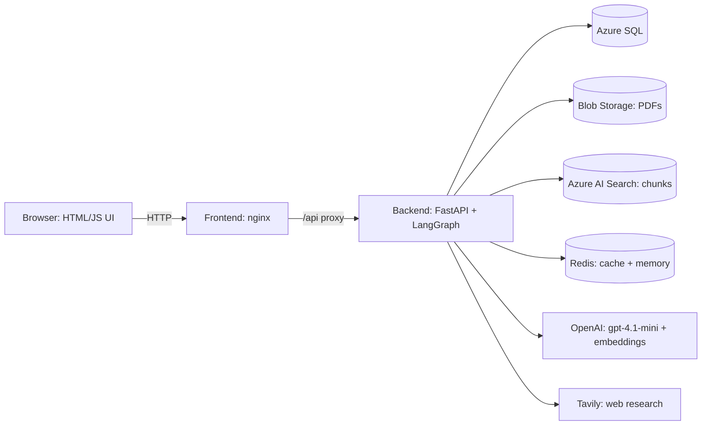

# Pharma Study Analyser

Upload a clinical-study PDF and get a structured, verifiable summary, a RAG chatbot grounded in that study, and ready-to-review sales and medical-affairs material. Built end to end: extraction, storage, retrieval, agents, UI, containers, CI/CD and deployment on Azure Kubernetes Service (AKS).

> Outputs are drafts for internal use. Anything customer-facing must be reviewed and approved by Medical Advisory / Regulatory first.

## What it does

| Area | Feature |
|---|---|
| Ingest | Upload a study PDF. The LLM extracts a structured study (design, arms, populations, outcomes, effect, CI, p-value) into Azure SQL. The PDF goes to Blob Storage and its chunks to Azure AI Search. |
| Verdict | A rule-based verdict from effect and confidence interval (HR / OR / RR, superiority vs non-inferiority). Plain code, no LLM, so it cannot hallucinate a conclusion. |
| Study chat (RAG) | Hybrid (vector + keyword) retrieval filtered per user and per study, LangGraph chat flow, Redis answer cache and conversation memory. |
| Buckets | Group studies into named buckets and chat or compare across them. |
| Sales and Marketing | Brochure (.docx), slide deck (.pptx), Q&A set, and medical-rep short and long call scripts. Every number is generated from database facts and re-checked in code against the source. |
| Smart PPT agent | Human-in-the-loop deck builder: the agent scans the study, proposes 5-6 points, the human adds notes or approves (60-minute window, auto-picks the best if no reply), then it builds up to 10 slides. |
| Medicine page | Web research (Tavily) for a drug: usage, adverse effects, brands and cost, company, mechanism of action and videos, studies, safety and compliance, and what happens without treatment. Source numbers are validated in code. |

## Architecture



Key design choices:
- **LLM for language, code for facts.** Numbers shown to users come from SQL; generated text is checked in code for numbers that are not in the source (`unverified_numbers`). Verdicts are rule-based.
- **Per-user isolation.** JWT auth; search filters and cache keys include the user and the study.
- **Graceful fallbacks.** SQLite when no Azure SQL is configured; process memory when Redis is not reachable.

## Repository layout

```
backend/            FastAPI app and agents
  api.py              REST endpoints, serves the UI in single-container mode
  auth.py             signup / login, JWT
  extract.py          PDF -> structured study
  verdict.py          rule-based verdict (no LLM)
  rag.py              chunking, embeddings, Azure AI Search (hybrid)
  chat_graph.py       LangGraph study chat and compare chat
  cache.py, memory.py Redis answer cache and conversation memory
  marketing.py        brochure / deck / Q&A / call scripts + docx and pptx export
  ppt_agent.py        human-in-the-loop PPT agent (LangGraph)
  medicine_agent.py   Tavily research agent for the Medicine page
  db.py, models.py    SQLAlchemy models and queries
  storage.py          Blob Storage
  Dockerfile          multi-stage backend image
frontend/           index.html, app.js, style.css, nginx.conf, Dockerfile
application_work/   golden evaluation data
k8s/                Kubernetes manifests (namespace, config, redis, backend, frontend)
infra/aks-setup.md  one-time Azure setup notes
azure-pipelines.yml Azure DevOps CI/CD
```

## Run locally

```bash
python -m venv .venv && source .venv/bin/activate    # Windows: .venv\Scripts\activate
pip install -r requirements.txt
# create a .env file with your own values (variable names below)
cd backend && uvicorn api:app --reload
```

Open http://localhost:8000. With no Azure SQL variables set, the app uses a local SQLite file.

Environment variables (names only, never commit values):

| Variable | Purpose |
|---|---|
| `OPENAI_API_KEY`, `OPENAI_CHAT_MODEL`, `OPENAI_EMBEDDING_MODEL` | LLM and embeddings |
| `JWT_SECRET` | signs login tokens |
| `AZURE_SQL_SERVER`, `AZURE_SQL_DATABASE`, `AZURE_SQL_USERNAME`, `AZURE_SQL_PASSWORD` | Azure SQL |
| `AZURE_SEARCH_ENDPOINT`, `AZURE_SEARCH_KEY`, `AZURE_SEARCH_INDEX_NAME` | Azure AI Search |
| `AZURE_STORAGE_CONNECTION_STRING`, `AZURE_STORAGE_CONTAINER` | Blob Storage |
| `REDIS_URL` | Redis (optional locally) |
| `TAVILY_API_KEY` | Medicine page web research |

## Containers

Two images, both multi-stage and running as a non-root user:
- `backend/Dockerfile` (build context = repository root): builds a virtualenv in a builder stage, then a slim runtime with the Microsoft ODBC driver 18 for Azure SQL. Runtime-only dependencies live in `requirements-api.txt`.
- `frontend/Dockerfile`: `nginx-unprivileged` serving the static UI and proxying `/api` to `BACKEND_URL` (default `http://backend:8000`).

## Deployment: Azure DevOps to AKS

`azure-pipelines.yml` has two stages:

1. **Build** - quick checks (Python compile, JS syntax, manifest YAML parse), then build and push `pharma-backend` and `pharma-frontend` to Azure Container Registry, tagged with the build id.
2. **Deploy** (main branch only, environment `pharma-prod`) - `az aks get-credentials`, create the namespace, create the Kubernetes secret `pharma-secrets` from the Azure DevOps variable group (secrets never live in Git), substitute the image names into `k8s/*.yaml`, `kubectl apply`, wait for rollouts, then a smoke test against the public endpoint.

Cluster layout (namespace `pharma`):
- `backend` - 1 replica (the PPT agent keeps sessions in process memory, so it is not yet horizontally scalable). Config from ConfigMap `pharma-config`, secrets from `pharma-secrets`.
- `frontend` - 2 replicas behind a `LoadBalancer` Service on a reserved static public IP.
- `redis` - in-cluster `redis:7-alpine` (cache and memory are disposable; swap to a managed Redis by changing `REDIS_URL`).

One-time setup (full commands in `infra/aks-setup.md`):
1. Create ACR and AKS; attach them: `az aks update -g <rg> -n <aks> --attach-acr <acr>`.
2. Reserve a static public IP and set it as `loadBalancerIP` in `k8s/40-frontend.yaml`.
3. Azure DevOps: Docker Registry service connection to ACR, Azure Resource Manager service connection to the AKS resource group, a variable group `pharma-secrets` (`OPENAI_API_KEY`, `JWT_SECRET`, `AZURE_SQL_PASSWORD`, `AZURE_SEARCH_KEY`, `AZURE_STORAGE_CONNECTION_STRING`, `TAVILY_API_KEY`), and an environment `pharma-prod`. Authorize the pipeline for each.
4. Allow the AKS outbound IP in the Azure SQL firewall.
5. Fill the non-secret values in `k8s/10-config.yaml`.

Lessons from the first deployment:
- ACR not attached to AKS gives `ImagePullBackOff`; attach it.
- Probe `timeoutSeconds: 1` on `/openapi.json` can restart the backend on cold start; raise it if you see restarts.
- A `.gitignore` rule for `*.html` also ignores `frontend/index.html`; add an exception or `git add -f`.

## Security notes

- No secrets in the repository: `.env` and local helper scripts are git-ignored; production secrets come from the pipeline variable group into a Kubernetes secret.
- Rotate any key that has ever been pasted into a chat, ticket or log.
- The medicine and marketing outputs carry a review note and are not for distribution without Medical Advisory / Regulatory approval.

## Known limitations and roadmap

- Study-to-study comparison agent (indirect comparison of different trials, with a clear "not head-to-head" label) is designed but not built yet.
- PPT agent sessions are in process memory; move them to Redis before running more than one backend replica.
- HTTPS and a custom domain (Ingress + certificate) are not set up yet.
- Download of the Medicine page as docx/PDF.
