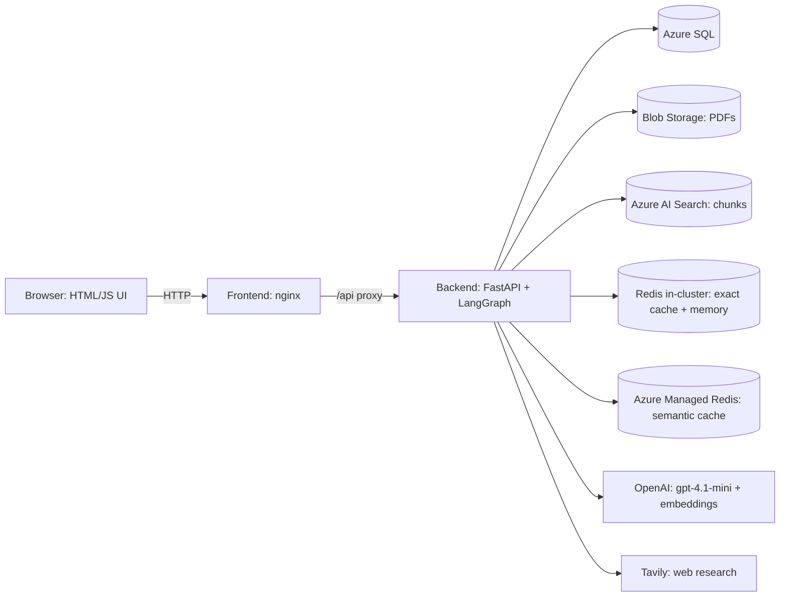

# Pharma Study Analyser

Upload a clinical-study PDF and get a structured, verifiable summary, a RAG chatbot grounded in that study, and ready-to-review sales and medical-affairs material. Built end to end: extraction, storage, retrieval, agents, UI, containers, CI/CD and deployment on Azure Kubernetes Service (AKS).

> Outputs are drafts for internal use. Anything customer-facing must be reviewed and approved by Medical Advisory / Regulatory first.

## What it does

| Area | Feature |
|---|---|
| Ingest | Upload a study PDF. The LLM extracts a structured study (design, arms, populations, outcomes, effect, CI, p-value) into Azure SQL. The PDF goes to Blob Storage and its chunks to Azure AI Search. |
| Verdict | A rule-based verdict from effect and confidence interval (HR / OR / RR, superiority vs non-inferiority). Plain code, no LLM, so it cannot hallucinate a conclusion. |
| Study chat (RAG) | Hybrid (vector + keyword) retrieval filtered per user and per study, LangGraph chat flow with guardrails (PII masking, refusal of personal medical advice, number-grounding check), a two-layer answer cache (exact match plus semantic cache on Azure Managed Redis) and conversation memory. |
| Buckets | Group studies into named buckets and chat or compare across them. |
| Sales and Marketing | Brochure (.docx), slide deck (.pptx), Q&A set, and medical-rep short and long call scripts. Every number is generated from database facts and re-checked in code against the source. |
| Smart PPT agent | Human-in-the-loop deck builder: the agent scans the study, proposes 5-6 points, the human adds notes or approves (60-minute window, auto-picks the best if no reply), then it builds up to 10 slides. |
| Medicine page | Web research (Tavily) for a drug: usage, adverse effects, brands and cost, company, mechanism of action and videos, studies, safety and compliance, and what happens without treatment. Source numbers are validated in code. |

## Architecture



Key design choices:
- **LLM for language, code for facts.** Numbers shown to users come from SQL; generated text is checked in code for numbers that are not in the source (`unverified_numbers`). Verdicts are rule-based.
- **Per-user isolation.** JWT auth; search filters and cache keys include the user and the study.
- **Graceful fallbacks.** SQLite when no Azure SQL is configured; process memory when Redis is not reachable.

## Repository layout

```
backend/            FastAPI app and agents
  api.py              REST endpoints, serves the UI in single-container mode
  auth.py             signup / login, JWT
  extract.py          PDF -> structured study
  verdict.py          rule-based verdict (no LLM)
  rag.py              chunking, embeddings, Azure AI Search (hybrid)
  chat_graph.py       LangGraph study chat and compare chat
  cache.py, memory.py Redis exact + semantic answer cache, conversation memory
  guards.py           PII masking, personal-advice refusal, number-grounding check
  obs.py              structured JSON logging with a request id
  marketing.py        brochure / deck / Q&A / call scripts + docx and pptx export
  ppt_agent.py        human-in-the-loop PPT agent (LangGraph)
  medicine_agent.py   Tavily research agent for the Medicine page
  db.py, models.py    SQLAlchemy models and queries
  storage.py          Blob Storage
  Dockerfile          multi-stage backend image
frontend/           index.html, app.js, style.css, nginx.conf, Dockerfile
application_work/   golden evaluation data (65 questions) and the RAGAS runner (run_ragas.py)
k8s/                Kubernetes manifests (namespace, config, redis, backend, frontend)
infra/aks-setup.md  one-time Azure setup notes
azure-pipelines.yml Azure DevOps CI/CD
```

## Run locally

```bash
python -m venv .venv && source .venv/bin/activate    # Windows: .venv\Scripts\activate
pip install -r requirements.txt
# create a .env file with your own values (variable names below)
cd backend && uvicorn api:app --reload
```

Open http://localhost:8000. With no Azure SQL variables set, the app uses a local SQLite file.

Environment variables (names only, never commit values):

| Variable | Purpose |
|---|---|
| `OPENAI_API_KEY`, `OPENAI_CHAT_MODEL`, `OPENAI_EMBEDDING_MODEL` | LLM and embeddings |
| `JWT_SECRET` | signs login tokens |
| `AZURE_SQL_SERVER`, `AZURE_SQL_DATABASE`, `AZURE_SQL_USERNAME`, `AZURE_SQL_PASSWORD` | Azure SQL |
| `AZURE_SEARCH_ENDPOINT`, `AZURE_SEARCH_KEY`, `AZURE_SEARCH_INDEX_NAME` | Azure AI Search |
| `AZURE_STORAGE_CONNECTION_STRING`, `AZURE_STORAGE_CONTAINER` | Blob Storage |
| `REDIS_URL` | in-cluster Redis for the exact-match cache and memory (optional locally) |
| `REDIS_HOST`, `REDIS_KEY` | Azure Managed Redis for the semantic cache (host without the port; the app builds `rediss://:key@host:10000`) |
| `SEMANTIC_CACHE_ENABLED`, `SEMANTIC_CACHE_DISTANCE_THRESHOLD`, `CACHE_TTL_SECONDS` | semantic cache switch (`true`), cosine-distance threshold (`0.11`), cache lifetime in seconds (`86400`) |
| `LOG_LEVEL` | log verbosity (default `INFO`) |
| `AZURE_OPENAI_ENDPOINT`, `AZURE_OPENAI_API_KEY`, `AZURE_OPENAI_EMBEDDING_DEPLOYMENT`, `AZURE_JUDGE_DEPLOYMENT` | Azure OpenAI used by the RAGAS evaluation (judge `gpt-4.1-mini` and embeddings) |
| `TAVILY_API_KEY` | Medicine page web research |

## Containers

Two images, both multi-stage and running as a non-root user:
- `backend/Dockerfile` (build context = repository root): builds a virtualenv in a builder stage, then a slim runtime with the Microsoft ODBC driver 18 for Azure SQL. Runtime-only dependencies live in `requirements-api.txt`.
- `frontend/Dockerfile`: `nginx-unprivileged` serving the static UI and proxying `/api` to `BACKEND_URL` (default `http://backend:8000`).

## Deployment: Azure DevOps to AKS

`azure-pipelines.yml` has two stages:

1. **Build** - quick checks (Python compile, JS syntax, manifest YAML parse), then build and push `pharma-backend` and `pharma-frontend` to Azure Container Registry, tagged with the build id.
2. **Deploy** (main branch only, environment `pharma-prod`) - `az aks get-credentials`, create the namespace, create the Kubernetes secret `pharma-secrets` from the Azure DevOps variable group (secrets never live in Git), substitute the image names into `k8s/*.yaml`, `kubectl apply`, wait for rollouts, then a smoke test against the public endpoint.

Cluster layout (namespace `pharma`):
- `backend` - 1 replica (the PPT agent keeps sessions in process memory, so it is not yet horizontally scalable). Config from ConfigMap `pharma-config`, secrets from `pharma-secrets`.
- `frontend` - 2 replicas behind a `LoadBalancer` Service on a reserved static public IP.
- `redis` - in-cluster `redis:7-alpine` for the exact-match cache and memory (disposable). The semantic cache lives in Azure Managed Redis; its host is in `k8s/10-config.yaml` and `REDIS_KEY` comes from the variable group into `pharma-secrets`.

One-time setup (full commands in `infra/aks-setup.md`):
1. Create ACR and AKS; attach them: `az aks update -g <rg> -n <aks> --attach-acr <acr>`.
2. Reserve a static public IP and set it as `loadBalancerIP` in `k8s/40-frontend.yaml`.
3. Azure DevOps: Docker Registry service connection to ACR, Azure Resource Manager service connection to the AKS resource group, a variable group `pharma-secrets` (`OPENAI_API_KEY`, `JWT_SECRET`, `AZURE_SQL_PASSWORD`, `AZURE_SEARCH_KEY`, `AZURE_STORAGE_CONNECTION_STRING`, `TAVILY_API_KEY`), and an environment `pharma-prod`. Authorize the pipeline for each.
4. Allow the AKS outbound IP in the Azure SQL firewall.
5. Fill the non-secret values in `k8s/10-config.yaml`.

Lessons from the first deployment:
- ACR not attached to AKS gives `ImagePullBackOff`; attach it.
- Probe `timeoutSeconds: 1` on `/openapi.json` can restart the backend on cold start; raise it if you see restarts.
- A `.gitignore` rule for `*.html` also ignores `frontend/index.html`; add an exception or `git add -f`.

## Chat flow, caching, guardrails and logging

```
input_guard -> (blocked: stop) -> load_memory -> rewrite -> check_cache
  cache hit  -> remember
  cache miss -> route_intent -> general: general_answer -> remember
                             -> study:   retrieve -> rerank -> (compress) -> generate
                                         -> output_guard -> save_cache -> remember
```

- **Guardrails (`guards.py`, rule-based on purpose: fast, free, predictable, testable).** `input_guard` masks PII (email, Aadhaar, PAN, phone numbers) and refuses questions that ask for personal medical advice. `output_guard` checks that every number in the answer appears in the retrieved excerpts; if not, the answer gets a warning note and is not cached. The intent router sends only maths, greetings, chit-chat and plain definitions to the general path; everything else is answered from the excerpts only.
- **Two-layer cache.** (1) Exact match: a hash of user, study scope and question in the in-cluster Redis. (2) Semantic cache: RedisVL `SemanticCache` on Azure Managed Redis with the `all-MiniLM-L6-v2` embedding, cosine-distance threshold `0.11` (smaller = stricter) and a 24-hour TTL. Hits are filtered by a `scope` tag, so a user only gets a cached answer for the same user and the same study (or compare set). Deleting a study also deletes its semantic entries. If Redis is down, the app still answers (no cache).
- **Logging (`obs.py`).** One JSON line per event on stdout with a request id, readable with `kubectl logs` or Container Insights. The `chat` event records scope, number of candidates and contexts, top retrieval score, cache hit and kind (`exact` or `semantic`), semantic distance, route (`study` or `general`), blocked flag, guard flags, answer length and latency. Keys, passwords and the full question or answer text are never logged.

## Evaluation (RAGAS)

A golden set of 65 questions from three studies (EMPA-REG, a CVOT review from SAVOR-TIMI to DECLARE-TIMI, and TECOS): 52 answerable questions with expected answers and 13 "not in the paper" questions that the app should refuse. The runner `application_work/run_ragas.py` asks every question through the real chat graph, then scores it with RAGAS using an Azure OpenAI judge (`gpt-4.1-mini`).

```
python application_work/run_ragas.py --user-id <user id> [--limit 2]
```

Results are saved as CSV in `application_work/golden/ragas_results/`.

**Baseline (first full run, 65 questions)**

| Metric | Score |
|---|---|
| Faithfulness | 0.970 |
| Context recall | 0.980 |
| Context precision (with reference) | 0.889 |
| Answer relevancy | 0.849 |
| Number recall (own check: expected numbers found in the answer) | 0.721 |

- number_recall = |numbers in expected answer ∩ numbers in model answer| / |numbers in expected answer|
- How it is computed

Extract all numbers from the expected answer and from the model answer (e.g. 7,020, 0.86, 63).
Normalize them: remove thousands separators (7,020 → 7020), ignore citation markers such as [p.3], and skip single-digit numbers.
Divide the count of shared numbers by the count of numbers in the expected answer.

Example

Expected: “HR 0.87, 95% CI 0.78-0.97, P = 0.01” → {0.87, 95, 0.78, 0.97, 0.01}
The answer contains {0.87, 0.78, 0.97, 0.01}, but not 95.
number_recall = 4 / 5 = 0.80

Why it exists: RAGAS metrics judge text with an LLM and can miss a wrong or missing statistic. This check is deterministic (no LLM judge) and verifies that the key clinical numbers (hazard ratios, confidence intervals, sample sizes) are actually present.

Limitations: it checks presence only, not context, so a number can match by chance. Different formats (seven thousand, 63.0 vs 63) can be missed, which may lower the score.


| Study | Faithfulness | Answer relevancy | Context precision | Context recall | Number recall |
|---|---|---|---|---|---|
| CVOT review | 1.000 | 0.801 | 0.878 | 1.000 | 0.744 |
| EMPA-REG | 0.945 | 0.892 | 0.929 | 1.000 | 0.698 |
| TECOS | 0.962 | 0.863 | 0.834 | 0.917 | 0.723 |
- Using a high power model can increase the result little more 
**What the baseline showed**

- Retrieval and grounding are strong (context recall 0.98, faithfulness 0.97).
- "Not in the paper" questions: the strict abstain check passed 0 of 13 (0%). Strong LLM work.
- A few answers (a drug price, a trial that is not in the paper) came from general knowledge, because the intent router sent them to the general-question path. Fix in progress: the router now sends everything that names a drug, trial, price or number to the study path, so the answer is limited to the excerpts. The numbers above will be refreshed after the next full run.
- Number recall (0.72) will be checked for formatting differences such as `7,020` versus `7020`.

## Security notes

- No secrets in the repository: `.env` and local helper scripts are git-ignored; production secrets come from the pipeline variable group into a Kubernetes secret.
- Rotate any key that has ever been pasted into a chat, ticket or log.
- The medicine and marketing outputs carry a review note and are not for distribution without Medical Advisory / Regulatory approval.

## Known limitations and roadmap

- Study-to-study comparison agent (indirect comparison of different trials, with a clear "not head-to-head" label) is designed but not built yet.
- PPT agent sessions are in process memory; move them to Redis before running more than one backend replica.
- HTTPS and a custom domain (Ingress + certificate) are not set up yet.
- Download of the Medicine page as docx/PDF.
